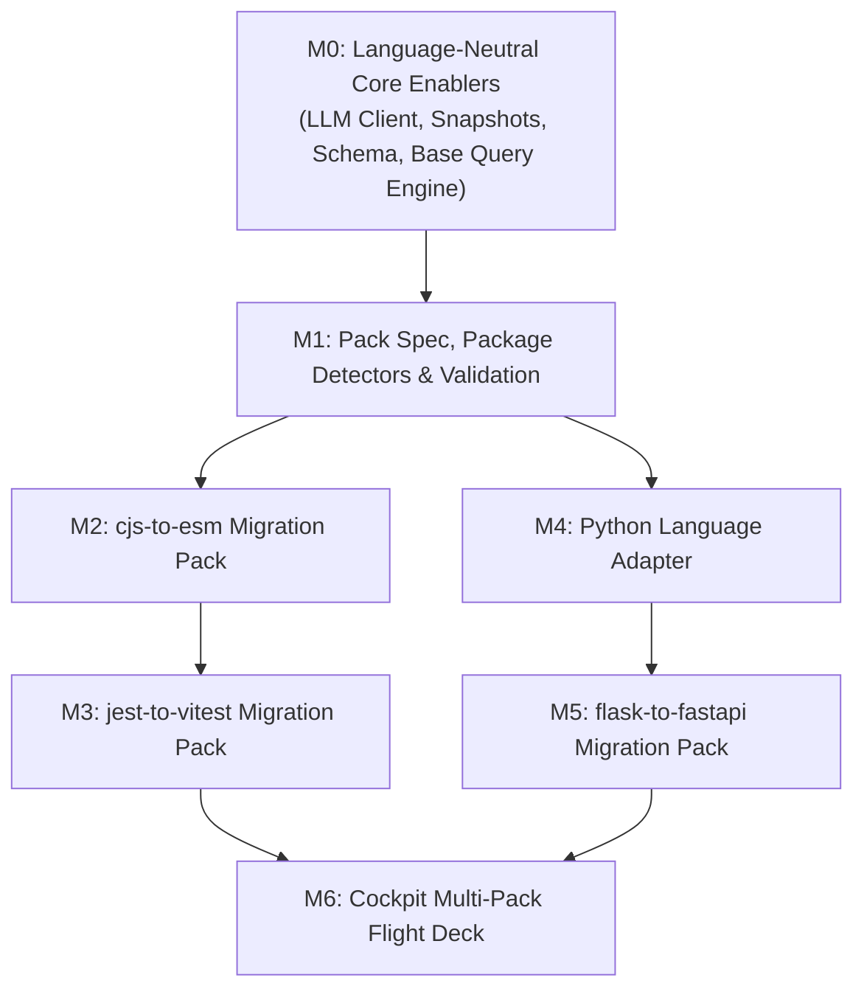

# Bagwan Kai Bandey (BKB) — Multi-Pack & Multi-Language Implementation Plan

This document serves as the technical blueprint and execution plan for expanding BKB beyond `express-to-fastify` to support pluggable migration packs:

1. **`cjs-to-esm`** (CommonJS `require()` / `module.exports` $\rightarrow$ ES Module `import` / `export`)
2. **`jest-to-vitest`** (Jest test runner, mocking API, and types $\rightarrow$ Vitest)
3. **`flask-to-fastapi`** (Python Language Adapter + Flask $\rightarrow$ FastAPI)

---

## 1. Executive Summary & Core Design Philosophy

BKB's strength is that its graph engine (topological sorting, cycle condensation via Tarjan's algorithm, Strangler Fig shimming, and state verification) is **language- and framework-agnostic**.

All framework-specific behavior is declared in **Migration Packs** (Layer 3), and all grammar-specific behavior is encapsulated in **Language Adapters** (Layer 2).

### Architectural Invariant
> The core engine (`src/engine/operations.ts`, `src/engine/graphManager.ts`) must never contain `if (language === 'python')` or pack-specific conditional logic. All capabilities are driven through adapter interfaces and declarative pack schemas.

---

## 2. Core Architectural Decisions (Prerequisites)

### D1 — Pack-Declared Shim Strategy (`shimStrategy`)
The engine's `SHIM` $\rightarrow$ `DE_SHIM` lifecycle (counting `@bkb-shim` markers) was originally designed for in-file branching (e.g. `sendSuccess(replyOrRes)` accepting both Fastify reply and Express response objects). This maps directly to `flask-to-fastapi` and `jest-to-vitest`, but not to module system migrations where dual syntax in a single file is invalid JavaScript.

We formalize `shimStrategy` in the pack definition:
- **`in-file-branch`** (*Default for API / framework migrations*):
  - Leaf modules implement dual-runtime signatures during `SHIM` (e.g., `globalThis.vi?.fn ?? globalThis.jest?.fn` or Python `req_or_dep`).
  - Legacy lines are tagged with `// @bkb-shim` (or `# @bkb-shim`).
  - At `DE_SHIM`, fallback branches and comments are pruned.
- **`runtime-interop`** (*For module system migrations like `cjs-to-esm`*):
  - In Node $\ge 22.12$, CommonJS callers can synchronously `require()` ES modules that do not contain Top-Level Await (TLA).
  - When a leaf module transitions to ESM, it exports pure ESM syntax, tagged with an interop marker `// @bkb-shim: esm-runtime-interop`.
  - Node $\ge 22.12$ is verified via an engine preflight check.
  - At `DE_SHIM`, all upstream callers have transitioned to `import`, and the interop comment is removed.

### D2 — Generalized Verification Snapshots (`verification.snapshots`)
`runCheckpointGate` currently hardcodes `routeSnapshotCmd` and treats command failure as a fatal error. We generalize this into generic global snapshots:

```typescript
interface VerificationSnapshot {
  id: string;
  command: string;
  kind: 'set' | 'count' | 'exact';
}
```
- **`kind: 'set'`**: Output is parsed as a JSON string array, sorted, and compared against baseline (e.g. HTTP route surfaces, exported symbol names).
- **`kind: 'count'`**: Output is parsed as numeric or structured counts (e.g. test suites and assertion counts).
- **`kind: 'exact'`**: Raw string equality against baseline output.
- **Graceful Skip**: If a pack declares no snapshots, snapshot comparison is cleanly skipped with 0 errors.
- **Backward Compatibility**: `routeSnapshotCmd` is preserved as a deprecated alias mapping to `{ id: 'route-surface', command: routeSnapshotCmd, kind: 'set' }`.

### D3 — Shared Tree-Sitter Query Adapter (`TreeSitterQueryAdapter`)
To prevent `PythonAdapter` from duplicating query compilation, query caching, capture extraction, and line formatting:
- Extract `TreeSitterQueryAdapter extends BaseLanguageAdapter`.
- Implements:
  - `queryCache: Map<string, Query>`
  - `getCompiledQuery(lang: Language, queryString: string): Query`
  - `evaluateDetectionRules(lang, root, lines, rules): APIUsage[]`
  - `evaluateInvariants(lang, root, invariants): Record<string, string[]>`
- `TypeScriptAdapter` and `PythonAdapter` become thin grammar and resolver subclasses.

### D4 — Language-Aware LLM Client & Per-Pack Mocks
In `src/runner/llmClient.ts`:
- **Code Fences**: Replace hardcoded ````typescript```` code fences with language-derived fences:
  - `typescript` / `javascript` $\rightarrow$ ````typescript```` / ````javascript````
  - `python` $\rightarrow$ ````python````
- **Prompt Parameterization**: System and user prompts derive output requirements from `pack.language` (`"Output only ${language} code."`).
- **Mock Transforms**: Replace hardcoded `MOCK_TRANSFORMS` with a mock resolver that checks `<fixtureDir>/.bkb-mocks.json` or `pack.mockTransforms`.

---

## 3. Milestone Sequencing & Work Breakdown



---

### Milestone M0: Language-Neutral Core Enablers
*Prerequisite milestone unblocking M1–M5 without breaking existing test suites.*

#### Deliverables
1. **LLM Plumbing**:
   - Parameterize `extractCodeFromMarkdown` to accept a language-specific fence pattern (supporting `ts`, `js`, `py`).
   - Parameterize prompt generation (`buildPrompt`) with `pack.language`.
   - Update system prompt from `"Output only TypeScript code"` to `"Output only ${language} code"`.
2. **Mock Injection Strategy**:
   - Update `LlmClient` to support injectable mock providers or per-fixture mock definitions (`.bkb-mocks.json`).
3. **Snapshot Generalization**:
   - Add `verification.snapshots` to pack schema.
   - Update `initMigrationGraph` in `src/engine/graphManager.ts` to capture baselines for all declared snapshots.
   - Update `runCheckpointGate` in `src/engine/operations.ts` to evaluate each snapshot by `kind` (`set`, `count`, `exact`), gracefully skipping when empty.
4. **Authoritative Schema Artifact**:
   - Create `packs/PACK_SPEC.schema.json` defining valid pack structures, detection rules, invariant scopes, and snapshot definitions.
5. **Resolver Enhancements**:
   - Add `.cjs` and `.mjs` to `TypeScriptAdapter` resolution extensions (`src/adapters/typescriptAdapter.ts:340`).
6. **Execution Robustness**:
   - Support `verification.timeoutMs` in packs to allow test runners like Vitest and Pytest sufficient execution time.

#### Verification Criteria
- All 55 existing tests continue to pass.
- Unit tests verify that `extractCodeFromMarkdown` handles ````python```` fences and that snapshot comparisons skip cleanly when no snapshots are configured.

---

### Milestone M1: Pack Specification, Package Detectors & Validation
*Establishes declarative package detection and strict CLI validation.*

#### Deliverables
1. **Package Detectors**:
   - Add `packageDetectors: { id: string; file: string; match: { legacy?: string[]; target?: string[] } }[]` to `PACK_SPEC.schema.json`.
   - Wire `graphManager` to parse project manifests (e.g. `package.json`, `pyproject.toml`) and create external package dependency nodes in FalkorDB.
2. **Schema & Semantic Validation**:
   - Create `bkb pack validate <path>` command using Ajv against `PACK_SPEC.schema.json`.
   - Add semantic validators: ensure commands are non-empty, reject checkpoint-scope invariants with an actionable hint to use snapshots, and verify AST query syntax.
3. **Migrate Built-in Pack**:
   - Update `packs/express-to-fastify.json` to conform to the new schema.

#### Verification Criteria
- `bkb pack validate packs/express-to-fastify.json` exits 0.
- Schema unit tests reject malformed packs and invalid AST queries.

---

### Milestone M2: `cjs-to-esm` Migration Pack

#### Deliverables
1. **Pack Definition (`packs/cjs-to-esm.json`)**:
   - `id`: `cjs-to-esm`
   - `language`: `typescript` (or `javascript`)
   - `shimStrategy`: `runtime-interop`
   - **Detection Rules**:
     - `cjs-require`: `(call_expression function: (identifier) @fn (#eq? @fn "require") arguments: (arguments (string) @path))`
     - `cjs-module-exports`: `(assignment_expression left: (member_expression object: (identifier) @obj property: (property_identifier) @prop (#eq? @obj "module") (#eq? @prop "exports")))`
     - `cjs-exports-assign`: `(assignment_expression left: (member_expression object: (identifier) @obj property: (property_identifier) @prop (#eq? @obj "exports")))`
     - `cjs-globals`: matches `__dirname` and `__filename` identifiers.
   - **Agent Guidance**:
     - `MIGRATE`: Replace `require()` with `import`, `module.exports` with `export default` / `export const`, and `__dirname` with `fileURLToPath(new URL('.', import.meta.url))`.
     - `SHIM`: Retain pure ESM exports with top-level `// @bkb-shim: esm-runtime-interop` comment.
     - `DE_SHIM`: Prune `// @bkb-shim` comments once callers have converted to `import`.
   - **Snapshots**:
     - `export-surface`: runs `node scripts/dump-exports.mjs` (`kind: "set"`).
2. **Preflight Node Version Gate**:
   - Validates that runtime Node is $\ge 22.12.0$ for native synchronous `require(esm)`.
3. **Demo Fixture (`demo-repo-cjs`)**:
   - 8 modules: foundational utilities, circular service dependencies, domain routes, and entrypoint.
   - Configured with `"allowJs": true` in `tsconfig.json`.
   - Includes `.bkb-mocks.json` for deterministic E2E runner tests.
4. **Automated Test Suite**:
   - `test/packs/cjsToEsm.test.ts`: validates AST queries, topological claim order, and full autonomous migration loop.

#### Verification Criteria
- Autonomous runner migrates `demo-repo-cjs` from 100% CJS to 100% ESM.
- Typecheck (`tsc --noEmit`) passes at every step; export snapshot matches baseline at checkpoints.

---

### Milestone M3: `jest-to-vitest` Migration Pack

#### Deliverables
1. **Pack Definition (`packs/jest-to-vitest.json`)**:
   - `id`: `jest-to-vitest`
   - `language`: `typescript`
   - `shimStrategy`: `in-file-branch`
   - **Detection Rules**:
     - `jest-calls`: matches `jest.fn()`, `jest.mock()`, `jest.spyOn()`, `jest.clearAllMocks()`, `jest.useFakeTimers()`.
     - `jest-types`: matches `jest.Mock<...>`, `jest.SpyInstance<...>`.
     - `packageDetectors`: matches `@types/jest`, `ts-jest`, `jest` in `package.json`.
   - **Agent Guidance**:
     - `SHIM`: Use `const getMock = () => (typeof globalThis.vi !== 'undefined' ? globalThis.vi : (globalThis as any).jest); // @bkb-shim` in shared test helpers.
     - `MIGRATE`: Replace `jest.mock()` with `vi.mock()`, import `{ describe, it, expect, vi } from 'vitest'`.
     - `DE_SHIM`: Remove `(globalThis as any).jest` fallbacks and `@bkb-shim` comments.
   - **Snapshots**:
     - `test-counts`: runs a script parsing test runner output and emits `{ suites: N, tests: M }` (`kind: "count"`).
2. **Demo Fixture (`demo-repo-jest`)**:
   - Express/TypeScript test suite featuring unit tests, shared mock factories, and integration tests.
3. **Automated Test Suite**:
   - `test/packs/jestToVitest.test.ts`: executes migration loop and runs `npx vitest run`.

#### Verification Criteria
- All `jest.*` references converted to `vi.*`.
- Test count snapshot confirms 100% of tests pass under Vitest without dropped test cases.

---

### Milestone M4: Python Language Adapter Foundation

#### Deliverables
1. **Tree-Sitter Base Extraction**:
   - Implement `TreeSitterQueryAdapter extends BaseLanguageAdapter` in `src/adapters/treeSitterAdapter.ts`.
   - Refactor `TypeScriptAdapter` to extend `TreeSitterQueryAdapter` (ensuring 100% backwards compatibility).
2. **Python Adapter Implementation (`PythonAdapter`)**:
   - Integrates `tree-sitter-python.wasm`.
   - Implements Python file discovery (`.py`, excluding `__pycache__`, `.venv`, `venv`, `.pytest_cache`).
   - Implements Python import resolution:
     - Dotted absolute imports (`import app.services.users` $\rightarrow$ `app/services/users.py`).
     - Relative package imports (`from .utils import response_json`).
   - Extracts Python universal symbols (functions, classes, decorated methods).
3. **Automated Test Suite**:
   - `test/adapters/pythonAdapter.test.ts`: verifies AST parsing, import edge discovery, symbol extraction, and Tarjan SCC cycle detection on Python code.

#### Verification Criteria
- `adapterRegistry.get('python')` resolves `PythonAdapter`.
- Graph construction accurately builds dependency edges and cycle components on Python fixtures.

---

### Milestone M5: `flask-to-fastapi` Migration Pack

#### Deliverables
1. **Pack Definition (`packs/flask-to-fastapi.json`)**:
   - `id`: `flask-to-fastapi`
   - `language`: `python`
   - `shimStrategy`: `in-file-branch`
   - **Detection Rules**:
     - `flask-app`: `(call function: (identifier) @fn (#eq? @fn "Flask"))`
     - `flask-route`: `(decorator (call function: (attribute object: (identifier) @obj property: (identifier) @prop (#match? @prop "^(route|get|post|put|delete)$"))))`
     - `flask-request-global`: `(import_from_statement module_name: (dotted_name) @mod (#eq? @mod "flask") name: (dotted_name) @name (#eq? @name "request"))`
     - `flask-helpers`: `jsonify`, `abort`, `render_template`.
   - **Agent Guidance**:
     - `SHIM`: Accept dual request payloads (`req_or_dep`) tagged with `# @bkb-shim`.
     - `MIGRATE`: Convert Flask view functions to async FastAPI endpoints with Pydantic models.
     - `DE_SHIM`: Remove thread-local `flask.request` fallbacks and `# @bkb-shim` comments.
   - **Snapshots**:
     - `route-surface`: runs `python scripts/dump_routes.py` (`kind: "set"`).
2. **Route Canonicalizer Algorithm (`scripts/dump_routes.py`)**:
   - Normalizes path parameter formats: Flask `<int:id>` $\rightarrow$ `{id}`.
   - Normalizes trailing slashes (except root `/`).
   - Excludes default `/static` endpoints.
   - Emits sorted `METHOD PATH` list.
3. **Typecheck & Test Tooling**:
   - `perStepTypecheckCmd`: uses non-strict `mypy --ignore-missing-imports` or `pyright`.
   - `checkpointTestCmd`: `pytest`.
   - Preflight helper skips or warns if `python3` or `pytest` are not installed on host.
4. **Demo Fixture (`demo-repo-flask`)**:
   - 7-file Python application: `app.py`, `routes/`, `services/`, `utils/`, with `pytest` suite.
5. **Automated Test Suite**:
   - `test/packs/flaskToFastapi.test.ts`: runs autonomous migration loop with injected mocks.

#### Verification Criteria
- End-to-end migration converts Flask app to FastAPI.
- Canonicalized route snapshot diff is 0; `pytest` passes 100%.

---

### Milestone M6: Cockpit Multi-Pack Flight Deck

#### Deliverables
1. **Dynamic Step State Decoupling**:
   - Decouple `STEP_CODE_STATES` and `CANNED_STEP_NAMES` in `src/server/demoServer.ts` from hardcoded Express constants.
   - Load step reference implementations dynamically from `<activeRepo>/.bkb-steps.json` or active pack metadata.
2. **Flight Deck UI Enhancements**:
   - Add pack dropdown selector in the Cockpit header.
   - Display language badges (`TypeScript`, `Python`) and active `shimStrategy`.
   - Update SSE telemetry events to broadcast active pack metadata.
3. **Automated UI Test Suite**:
   - Verify that switching packs via `POST /api/target` reconfigures the graph visualizer without Express-specific assumptions.

#### Verification Criteria
- Cockpit visualizer renders topology, PageRank, and live step transitions for all 4 packs from a single web interface.

---

## 4. Verification Matrix & Testing Protocol

Every pack adheres to the 4-level verification pyramid:

```
                  ┌────────────────────────┐
                  │ Level 4: E2E Runner    │ -> Autonomous loop with mock/real LLM
                  ├────────────────────────┤
                  │ Level 3: Checkpoint    │ -> Full test suite + Global Snapshots (set/count)
                  ├────────────────────────┤
                  │ Level 2: Per-Step AST  │ -> Compiler typecheck (tsc / mypy) + Invariants
                  ├────────────────────────┤
                  │ Level 1: Unit & Schema │ -> Ajv JSON schema + AST query matching
                  └────────────────────────┘
```

### Zero-Docker Unit Test Policy
To prevent tests from hanging in CI or on machines without Docker:
- **Unit & AST Tests**: Run purely in-memory using Web-Tree-Sitter WASM parsers. Zero database calls.
- **Pack Runner E2E Tests**: Use `createMockClient(...)` to simulate FalkorDB graph operations in-process, or pass `autoInit: false` where server instantiation is required.
- **Execution Timeouts**: All asynchronous runner tests define explicit timeouts (`timeoutMs: 30000`).

---

## 5. Risk Register & Mitigations

| Risk | Severity | Mitigation |
|---|---|---|
| **Node.js `< 22.12` running `cjs-to-esm`** | High | Add engine preflight check asserting `process.versions.node >= 22.12`. Fail fast with an actionable error. |
| **Undecidable dynamic CJS exports** | Medium | `export-surface` AST rule is best-effort; the runtime export snapshot (`scripts/dump-exports.mjs`) is the authoritative gate. |
| **`mypy --strict` failing on intermediate Python steps** | High | Configure `perStepTypecheckCmd` with non-strict flags (`mypy --ignore-missing-imports` or `pyright`). |
| **Flask vs. FastAPI route format discrepancies** | High | Implement deterministic route canonicalizer in `dump_routes.py` normalizing `<type:param>` to `{param}`. |
| **Test runner timeout during `checkpointTestCmd`** | Medium | Support `verification.timeoutMs` in pack schema; default Vitest/Pytest to 30s. |
| **Host machine lacks Python toolchain** | Low | Gate Python E2E integration tests behind binary availability check (`checkBinaryAvailable('python3')`). Skip gracefully in environments without Python. |
