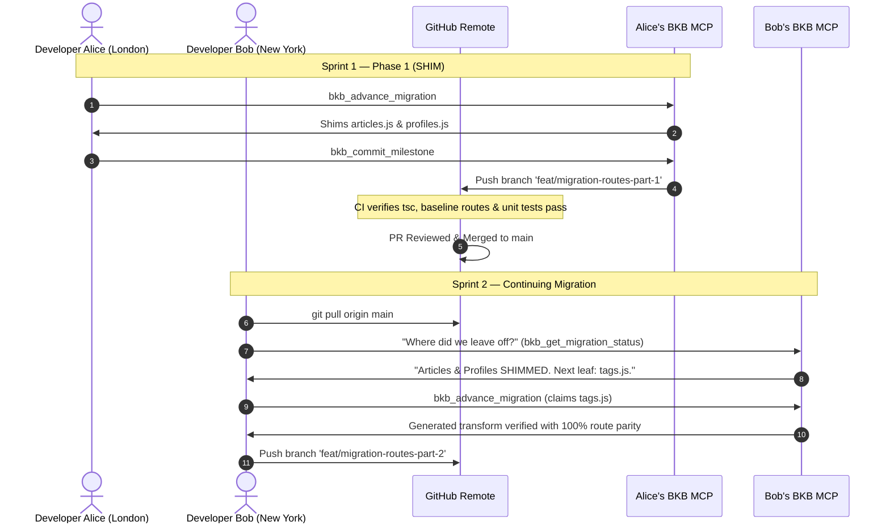

# Phased Migrations & Team Handoff Architecture
## Why BKB Exists and How Distributed Teams Safely Migrate Massive Codebases

---

## 1. Executive Summary: The Context Window Trap

The prevailing belief in AI-assisted software engineering is that **larger LLM context windows (128k, 1M, or 2M tokens) solve codebase refactoring**. The assumption is simple: *dump the entire 100-file repository into a prompt, instruct the model to migrate Express to Fastify or CommonJS to ESM, and let the agent write the diff.*

In enterprise software engineering, this approach fails predictably on any codebase over 5,000 lines of code:

1. **Myopic Hallucination & Blast Radius Blindness:** An LLM refactoring `src/services/auth.js` does not retain an active constraint solver for the 18 other files across the repository that invoke `verifyToken()`. It rewrites the signature, breaking callers. When prompted to fix the caller, it hallucinates new helper methods, breaking further dependencies in a cascading failure loop.
2. **Quadratic Cognitive Degradation:** As context windows fill up, models experience "lost in the middle" degradation, inconsistent rule adherence, and loss of type-invariant strictness.
3. **The Unreviewable PR Anti-Pattern:** No engineering organization will merge an automated PR with `+15,000 / -18,000` line diffs touching 70 files across an active service. A single undetected subtle semantic difference will take down production.

**Bagwan Kai Bandey (BKB) takes the opposite approach:**
The LLM is treated as an isolated, 1-hop AST worker bee. The **Graph (FalkorDB)** is the architect and governor.

```
       ┌──────────────────────────────────────────────────────────┐
       │               BKB Graph Governor (FalkorDB)              │
       │  • Directed Import Graph      • Tarjan SCC Cycles        │
       │  • PageRank Centrality        • Invariant Hash Database  │
       └─────────────────────────────┬────────────────────────────┘
                                     │ 
                Topological Order    │ Claims 1 Module / Cycle
                                     ▼
                      ┌─────────────────────────────┐
                      │    1-Hop Migration Slice    │
                      │  • Target AST Source        │
                      │  • Callee Export Signatures │
                      │  • Caller Import Snippets   │
                      │  • Strict Invariant Rules   │
                      └──────────────┬──────────────┘
                                     │ (~1,500 Tokens Only)
                                     ▼
                      ┌─────────────────────────────┐
                      │ LLM Worker (DeepSeek/Claude)│
                      └──────────────┬──────────────┘
                                     │ Pure Transformed Code
                                     ▼
                      ┌─────────────────────────────┐
                      │    Compiler & Gate Check    │
                      │  • AST Syntax Validation    │
                      │  • tsc / mypy Zero Errors   │
                      │  • 100% Snapshot Invariance │
                      └─────────────────────────────┘
```

---

## 2. The Core Value Proposition: Why Use BKB?

| Dimension | Raw LLM / Unbounded Agent | Bagwan Kai Bandey (BKB) |
|---|---|---|
| **Context Consumption** | 50,000 to 200,000+ tokens per step (expensive, slow, hallucination-prone) | **~1,500 tokens per step** (1-hop slice only; fast, cheap, deterministic) |
| **Dependency Order** | Random, greedy, or alphabetical file selection | **Strict Callee-First Topological Order** (leaves first, roots last) |
| **Circular Dependencies** | Infinite loops or broken cross-imports | **Tarjan SCC Detection**; cycles claimed and verified in atomic batches |
| **Zero-Downtime Guarantee** | Breaks intermediate builds; all-or-nothing | **Strangler Fig Pattern**; dual-compatible shims allow callers to run legacy syntax while callees run modern syntax |
| **Verification Gate** | "Looks good to the model" | **Automated Compiler Gate** (`tsc`, `mypy`), AST pattern verification, and Snapshot Invariants (routes, exports, test counts) |
| **Self-Healing Loop** | Blind retries that compound errors | **Diagnostic Feed Injection**; exact compiler & invariant errors fed back to model for targeted repair |

---

## 3. The Enterprise Reality: Migrations Happen in Phases Across Sprints

Large-scale migrations are **not single-session terminal runs**. In real organizations:

- A 50k–200k LOC monolith migration takes **several weeks or multiple sprints**.
- **Sprint 1 (Team A):** Migrate and shim the utility layer (`src/utils/*`, `src/helpers/*`).
- **Sprint 2 (Team B):** Migrate and shim domain services (`src/services/*`, `src/models/*`).
- **Sprint 3 (Team C):** Migrate HTTP entrypoints and controllers (`src/routes/*`, `src/server.ts`).
- **Sprint 4 (All Teams):** De-shim legacy compatibility branches once all callers are modernized.

Between these sprints, **the codebase must remain deployable to production**. Tests must pass, CI/CD pipelines must remain green, and other product engineers must be able to continue shipping unrelated features without merge conflicts.

---

## 4. Git-Native Persistence: The `.bkb/manifests/<packId>.json` Specification

Currently, graph states exist inside FalkorDB (`falkor://127.0.0.1:6379`). To enable **asynchronous, multi-team, distributed migration workflows**, BKB introduces the committed **Migration Manifest** (`.bkb/manifests/<packId>.json`), one file per migration pack.

### File Location & Git Lifecycle
- Stored at `<repoRoot>/.bkb/manifests/<packId>.json` (the pack id is slugified into the filename).
- **Committed to Git** alongside each migration milestone.
- When any engineer or CI runner clones the repo or checks out a branch, BKB synchronizes FalkorDB directly from this committed manifest.

### Schema Specification
```json
{
  "$schema": "https://bkb.dev/manifest.schema.json",
  "version": "1.0.0",
  "packId": "express-to-fastify",
  "migrationEpoch": "2026-10-17T02:00:00.000Z",
  "phase": "SHIM",
  "baseline": {
    "snapshotType": "route-surface",
    "hash": "e3b0c44298fc1c149afbf4c8996fb92427ae41e4649b934ca495991b7852b855",
    "command": "python3 scripts/dump_routes.py",
    "entryCount": 18,
    "entries": [
      "GET /api/articles",
      "POST /api/articles",
      "GET /api/profiles/:username",
      "POST /api/users/login"
    ]
  },
  "modules": {
    "routes/api/articles.js": {
      "status": "SHIMMED",
      "phase": "SHIM",
      "step": 1,
      "sccId": "scc_articles_01",
      "verifiedCommit": "ba04b70e1",
      "lastModified": "2026-10-17T02:30:12.000Z",
      "invariants": {
        "compilerErrors": 0,
        "matchedRoutes": 6,
        "legacyUsageShimmed": true
      }
    },
    "routes/api/profiles.js": {
      "status": "SHIMMED",
      "phase": "SHIM",
      "step": 2,
      "sccId": "scc_profiles_02",
      "verifiedCommit": "ba04b70e1",
      "lastModified": "2026-10-17T02:35:45.000Z",
      "invariants": {
        "compilerErrors": 0,
        "matchedRoutes": 3,
        "legacyUsageShimmed": true
      }
    },
    "routes/api/users.js": {
      "status": "PENDING",
      "phase": "SHIM",
      "inDegree": 2,
      "pendingCallers": 2
    }
  },
  "history": [
    {
      "step": 1,
      "phase": "SHIM",
      "modules": ["routes/api/articles.js"],
      "action": "Shimmed Express route handlers to Fastify reply dual-compatibility",
      "verifiedBy": "DeepSeek-V4.1-Flash",
      "timestamp": "2026-10-17T02:30:12.000Z"
    }
  ]
}
```

---

## 5. Native MCP Protocol: Milestone Commits & Team Handoff

To enable AI agents (Cursor, Claude Desktop, Windsurf, OpenCode) to participate in phased team workflows, the BKB MCP server exposes native milestone and handoff tools:

### 1. `bkb_commit_milestone`
When an atomic module or SCC cycle passes verification, the agent can commit the passing state to Git with full invariant audit metadata.

**Parameters:**
- `targetPaths`: Array of file paths just verified.
- `message`: Optional descriptive message.
- `createBranch`: Optional branch name (e.g., `feat/migration-step-2`).

**Generated Git Commit Format:**
```text
chore(migration): shim routes/api/profiles.js to Fastify [bkb-step-2]

- Migration Pack: express-to-fastify
- Verified Invariants: 18/18 baseline routes preserved (100% parity)
- Compiler Gate: tsc --noEmit (0 errors)
- Shim Strategy: in-file-branch (@bkb-shim)
- Blast Radius: 0 unhandled callers
- FalkorDB Node State: SHIMMED
```

### 2. `bkb_get_migration_status`
Enables any team member or agent resuming work on any machine to query exact topological progress:

**Agent Prompt Example:**
> *"Where did the team leave off on the Fastify migration, and what should I work on next?"*

**MCP Response:**
```json
{
  "activePack": "express-to-fastify",
  "activePhase": "SHIM",
  "progress": {
    "totalModules": 13,
    "shimmed": 2,
    "verified": 0,
    "pending": 11,
    "percentComplete": 15.4
  },
  "lastCommit": "ba04b70 (routes/api/profiles.js SHIMMED by Alice)",
  "unblockedLeavesReady": [
    {
      "path": "routes/api/tags.js",
      "inDegree": 1,
      "pendingCallers": 1,
      "priority": "HIGH"
    }
  ],
  "recommendation": "Call claim_next_leaf to begin migrating routes/api/tags.js."
}
```

---

## 6. Multi-Team Workflow Walkthrough



---

## 7. Summary: From Local Experiment to Enterprise Infrastructure

By anchoring graph intelligence in **topological slices**, **the Strangler Fig Pattern**, and **Git-committed migration manifests**, BKB transforms codebase migrations from a risky, unreviewable gamble into a **deterministic, phased, multi-team engineering process**.
